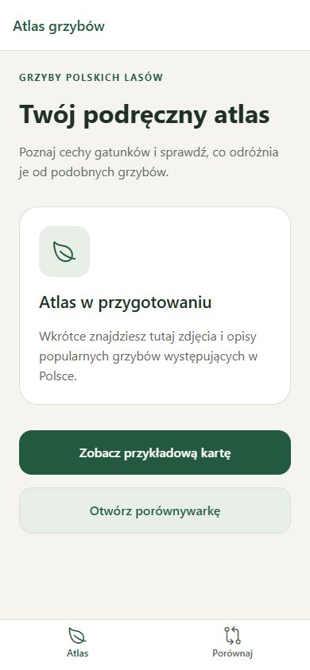

# Phase 1 acceptance report

Validation date: 2026-10-09.

Acceptance criterion: the app launches with Polish UI and working navigation.

Result: development checks and browser acceptance passed. Native launch acceptance remains pending.

## Completed checks

| Check                                          | Result                                                                 |
| ---------------------------------------------- | ---------------------------------------------------------------------- |
| `npm run check` (TypeScript, ESLint, Prettier) | Passed                                                                 |
| `npm run export:android`                       | Passed; Hermes bundle and 28 assets exported to `dist/android`         |
| Browser launch at `/`                          | Passed; Polish atlas UI displayed                                      |
| Atlas and comparison tabs                      | Passed in both directions                                              |
| Atlas action links to details and comparison   | Passed                                                                 |
| Details header back link                       | Passed; returned to the atlas                                          |
| Details → comparison → atlas                   | Passed                                                                 |
| Unknown species identifier                     | Passed; Polish missing-species message and working atlas recovery link |
| Unknown route                                  | Passed; Polish missing-page message and working atlas recovery link    |
| Browser console                                | No captured warnings or errors during the checked flows                |

Browser validation used the local Expo web development preview in the Codex in-app browser at a 390 × 844 viewport. The atlas, comparison, and details screens visibly label their content as work in progress. The details preview is a navigation placeholder, not a verified species entry.

## Environment notes

Expo telemetry was disabled for the acceptance commands with `EXPO_NO_TELEMETRY=1`. The initial sandboxed export encountered permissions errors in the Expo user-state and Hermes temporary directories. Export succeeded after directing temporary files into `.expo/acceptance-temp`, and also passed outside the sandbox with the normal temporary directory. The sandboxed web preview was unreachable from the browser; the successful browser checks used a localhost preview outside the sandbox. These workarounds required no application code changes.

## Pending native acceptance

The Android export is a JavaScript/Hermes bundle, not an APK or evidence of native startup. No emulator was installed or launched, and no physical device was tested.

- Launch on Android and confirm Polish UI.
- Switch tabs and open details on Android.
- Verify Android system back behavior and details → comparison → atlas navigation.
- Check native safe areas, small screens, and larger system font sizes.
- Perform a physical-device check when available.

Phase 1 retains its status: **Development implemented; native validation pending**.
