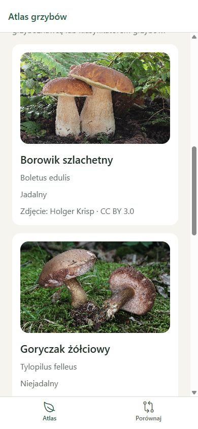

# Phase 2 acceptance report

Validation date: 2026-10-09.

Development result: the shared model and local dataset can supply atlas, details, and comparison screens. Native standalone/offline validation and independent mycological review remain pending.

- Five complete species cover edible, inedible, and poisonous categories.
- Fifteen licensed photographs are bundled with static imports, Polish captions, view/stage metadata, authors, file sources, license URLs, modification notes, and SHA-256 hashes.
- One sourced bolete comparison supports lookup in either order. Lookalikes outside the initial dataset are descriptive records without broken IDs.
- `npm run check` passed: schema/file/hash validation, 13 positive and negative validator tests, TypeScript, ESLint, and Prettier.
- `npm run export:android` passed with 43 assets. Every one of the 15 expected photo hashes matched an exported asset. Local photo files total 5,081,242 bytes before later thumbnail optimization.
- Browser preview at 390 × 844 displayed five Polish entries with scientific names, categories, author/license credits, and a visible pending-review notice. All five rendered photos loaded from localhost asset URLs. No captured browser warnings or errors occurred.

Content sources, review meaning, and update rules are documented in [data maintenance](../data-maintenance.md). Image attribution is in [photo credits](../photo-credits.md). Source taxon labels and visual screening are not proof of independent expert identification. The review gate remains pending in both metadata and UI.

The Android export proves bundle inclusion, not installation, native rendering, or first-launch airplane-mode behavior. Those checks need a later standalone APK and available device. No emulator was installed or launched.
