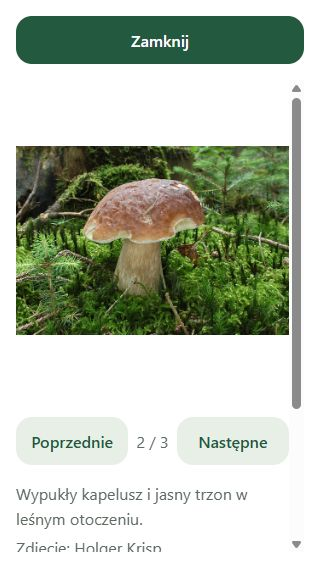

# Phase 3 acceptance report

Validation date: 2026-10-09.

Development result: shared UI and screen layouts implemented; native large-font and safe-area validation pending.

- Shared components cover cards, edibility icon/text/color badges, galleries and enlargement, feature lists, occurrence months, selection, comparison rows, safety notices, actions, and source links.
- Species cards now open an initial details layout with identity, category/note, key features near the top, gallery, and occurrence months. Complete descriptive sections remain Phase 5 work.
- Selection modals provide search and cancel, retain a chosen species, and disable choosing the same species for the other slot. Actual feature comparison remains Phase 6 work.
- Browser checks at 320 × 568 confirmed readable wrapping of long Polish names and key features, visible modal actions, photo switching and enlargement, captions/credits, selector search by Latin name, duplicate exclusion, and cancel. No captured browser warnings/errors occurred.
- Android export and `npm run check` passed. See [the UI design](../ui-design.md) for the complete layout specification and component conventions.

Actual Android safe areas, system back, and increased system font sizes remain pending; browser width testing does not prove these native behaviors. Independent content review also remains pending. No emulator was installed or launched.
