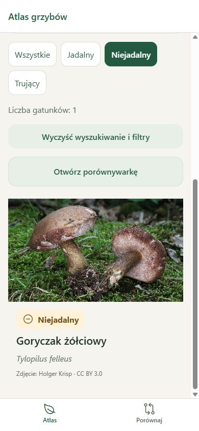

# Phase 4 acceptance report

Validation date: 2026-10-09.

Development result: local atlas search, combined edibility filtering, Polish sorting, empty results/reset, and browsing-state restoration implemented.

- Search covers Polish and Latin names and synonyms, case, surrounding whitespace, combining marks, and an explicit `ł` → `l` mapping. The species selector shares the same query function.
- Automated tests check all Polish diacritics, whitespace, name/synonym searches, combined filters, empty results, Polish alphabetical order, and input immutability. `npm run check` passes 17 tests plus data, type, lint, and formatting checks.
- Browser at 390 × 844: `zolciowy` found the inedible goryczak entry. Selecting the edible filter produced zero results and a working clear action. Reset restored five species. `kurka` found pieprznik jadalny.
- Opening details and using the header back link retained the exact query, inedible filter, and measured scroll offset of 468 pixels.
- Processing uses bundled JSON and a single virtualized list. Query/filter/offset persist within the application session, including route remounts; no account, server, or storage permission is required.

No application errors were captured. A development-only Metro disconnect warning was recorded when the preview server was intentionally restarted between phases. Native navigation, list responsiveness on a device, and native keyboard/font behavior remain pending. Source/expert content review status remains unchanged.
