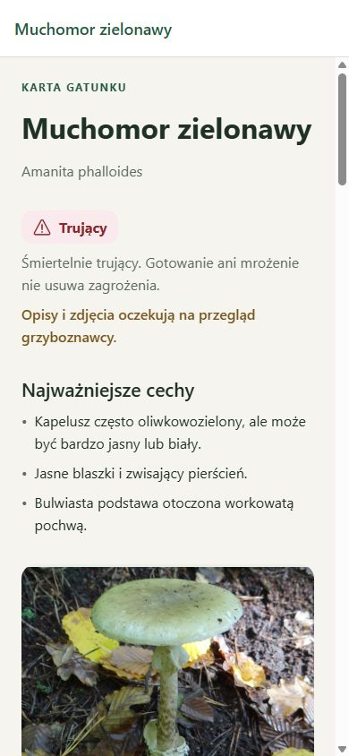

# Phase 5 acceptance report

Validation date: 2026-10-09.

Development result: complete species detail screens implemented for the bundled dataset. Independent content review and native validation remain pending.

- Every species has identity, category and note, key facts near the top, a local gallery with enlargement/captions/credits, identification tips, morphology, damage reactions, habitat, months and variability notes, similar-species descriptions, references, and all three photograph credits.
- Available lookalikes link to details and direct two-species comparison. Unbundled lookalikes show a clear availability note without creating broken routes.
- Comparison entry preselects the first species; a documented lookalike action preselects both. Unknown or duplicate parameters do not create two identical selections. Actual comparison rendering remains Phase 6 work.
- Source review date/version and specialist-review status are displayed. The legacy `/mushrooms/preview` now receives the normal unknown-species recovery; no placeholder is displayed as species information.
- Browser at 390 × 844 checked all 12 required section headings on every one of the five hydrated species pages. Each page exposed credits for all three images plus the active gallery image. The borowik → goryczak → comparison flow preselected the correct IDs, including reversed order. Single-species entry from muchomor zielonawy populated only the first slot. No application console errors occurred.
- `npm run check` passed with 17 tests; Android bundle export passed.

Native safe-area, system-back, large-font, and standalone offline behavior remain pending. Source checks are recorded honestly and are not specialist sign-off.
