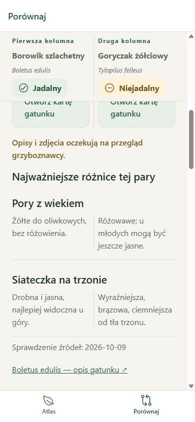

# Phase 6 acceptance report

Validation date: 2026-10-09.

Development result: every different pair in the bundled dataset can be compared locally. Native behavior and specialist verification remain pending.

- Searchable selectors reuse Polish normalization and synonyms. Either slot can be replaced; selecting the other slot's species is disabled in the selector and rejected by the shared selection utility. Unknown and identical deep-link parameters resolve to a recoverable incomplete selection.
- Details and lookalike actions preselect one or both species. The full atlas → borowik details → goryczak details → comparison → atlas browser flow preserved the atlas query.
- Two photo columns include captions, attribution, sources, license links, and access to details. Persistent Polish/Latin identity and category labels remain visible during shared vertical scrolling.
- Nine aligned feature rows show key facts, edibility and notes, cap, stem, hymenophore, flesh, damage reactions, habitat, and occurrence months/variability. Each row uses equal-width columns with shared height and no text truncation.
- The documented borowik/goryczak pair shows prominent source-checked differences and references. Swapping reverses the values as well as names and photos. Other pairs retain full descriptions and explicitly state that no curated pair analysis is available.
- Automated checks cover parameter recovery, replacement, duplicate prevention, reversible swapping, pair lookup in both orders, data immutability, and selection/curation across every ordered different pair. All 22 tests passed with TypeScript, lint, and formatting checks.
- Browser checks rendered every one of the ten unordered pairs with all nine required headings and both photos. Search by Latin name and the synonym `kurka`, duplicate exclusion, replacement, swapping, and the full navigation flow passed without application errors.
- At 320 × 568, long names and notes wrapped without horizontal page overflow. The identity panel stayed at the top while content scrolled. At 390 × 844, the curated difference rows stayed aligned beneath the persistent identity panel.
- Android bundle export passed and includes the 15 bundled photographs.

The differences are source-checked, with specialist review explicitly pending in the app. Native sticky-header behavior, system back, large-font accessibility, and first-launch offline validation require device testing.
