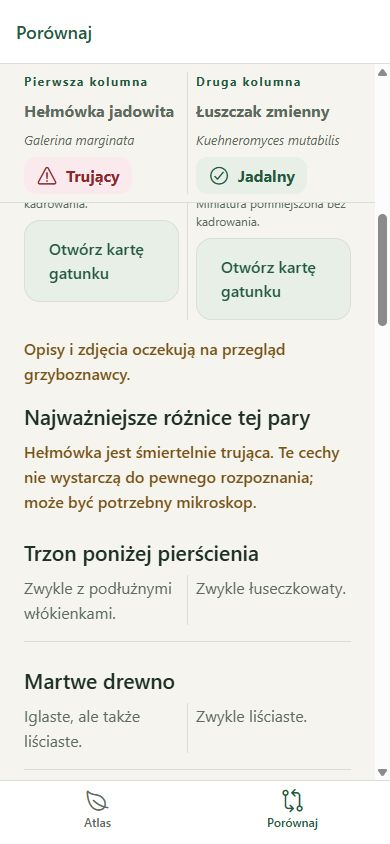

# Phase 7 acceptance report

Validation date: 2026-10-09. Dataset version: `0.7.0`.

Development result: the expanded atlas and image assets are bundled locally. Independent content verification and standalone first-launch offline behavior remain pending.

- The dataset contains 30 species and 12 curated comparisons, including poisonous lookalikes. Every entry has the required morphological sections, habitat, approximate occurrence months, lookalikes, notes, sources, and two or three photographs.
- Sources, Commons metadata, attribution, licenses, and visible photograph features were checked. This is preliminary source checking and visual screening, not expert identification. All records retain source-checked status; the app shows the pending specialist review notice.
- Conditional edibility and conflicting source classifications are qualified in species notes. Those notes also appear on atlas cards. Dangerous curated pairs include explicit limits on identification from visible features. A review inventory records unresolved taxonomy, months, source disagreements, and photograph limitations. No specialist has been contacted or assigned.
- Sixty-six source photographs total 23,778,549 bytes. Sixty-six uncropped local thumbnails total 3,043,828 bytes, approximately 87% smaller. Thumbnail processing is documented and preserves original attribution and license obligations. Atlas cards and comparison use thumbnails; galleries retain larger photographs.
- `npm run check` passed dataset validation, 27 tests, TypeScript, ESLint, and formatting checks. Tests include scientific aliases and ordered comparison lookup across all 870 different ordered selections.
- Android export passed. `npm run verify:android` found all 66 source and 66 thumbnail SHA-256 values among its 160 declared assets; the bundle and icon fonts are present. This establishes export inclusion, not APK installation or cache-independent device behavior.
- Browser validation rendered the required sections on all 30 detail pages. All 12 curated pairs rendered in both column orders with both photographs and correctly ordered identities. Scientific alias `Xerocomus badius` found the current taxon; synonym `kurka` combined with the inedible filter found its lookalike. The three-photo Galerina gallery, boundary controls, enlargement, and close action worked.
- The specialist qualification for Galerina versus Kuehneromyces remains prominent above the curated differences. Small-screen wrapping and native behavior remain subject to the final device checklist.

Required before full acceptance: independent review of every description and photograph, an installable Android build, first launch in airplane mode without Metro or a populated cache, and native navigation/accessibility checks. See [the content review inventory](../content-review.md).
